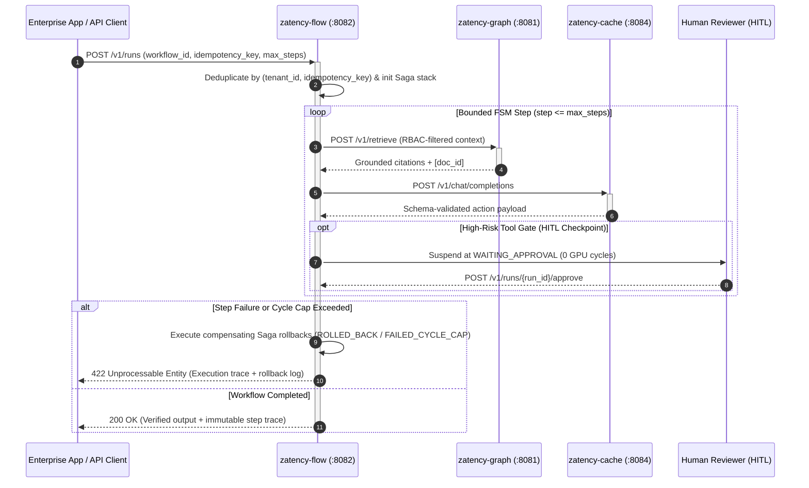

# zatency-flow — Deterministic Finite State Machine (FSM) Multi-Agent Orchestrator

**Bounded `max_steps` Cycle Guards, Schema-Validated Tool Contracts, `(tenant_id, idempotency_key)` Deduplication, Automatic Saga Rollbacks, and Zero-Compute Human-in-the-Loop (HITL) Checkpoints.**

[](https://zatency.com)
[](#api-reference)
[](https://www.apache.org/licenses/LICENSE-2.0)
[](#execution-lifecycle--architecture)
[](#quickstart)

---

## Sections
- [Overview](#overview)
- [Execution Lifecycle & Architecture](#execution-lifecycle--architecture)
- [Core Capabilities](#core-capabilities)
- [Deterministic Control & Resilience Benchmarks](#deterministic-control--resilience-benchmarks)
- [Quickstart](#quickstart)
- [API Reference](#api-reference)
- [Configuration](#configuration)
- [Security & Observability](#security--observability)
- [Open-Core vs. Enterprise Edition](#open-core-vs-enterprise-edition)
- [Ecosystem Integration](#ecosystem-integration)

---

## Overview

**`zatency-flow`** is the deterministic multi-agent workflow orchestrator of the **[Zatency Platform](https://github.com/zatency)**. Unbounded, non-deterministic LLM loops fail in regulated enterprise operations due to runaway token burn, duplicate financial/ERP mutations, and unreviewed high-risk tool executions. `zatency-flow` replaces open-ended agent recursion with state-bounded Finite State Machine (FSM) execution graphs.

Engineered for **single-tenant private VPCs (AWS, Microsoft Azure, Google Cloud)** and **physically air-gapped clusters**, `zatency-flow` enforces strict `max_steps` cycle caps, validates tool inputs against JSON schemas prior to execution, suspends workflows at `WAITING_APPROVAL` with zero GPU idle compute, and executes compensating Saga rollbacks in reverse order on downstream errors.

---

## Execution Lifecycle & Architecture

`zatency-flow` runs on default port **`:8082`**, retrieving RBAC-filtered context from `zatency-graph` (`:8081`), routing model completions through `zatency-cache` (`:8084`), and sealing execution traces into `zatency-ledger` (`:8085`):



---

## Core Capabilities

- **Bounded Cycle Caps (`max_steps`):** Terminates cyclic or stalled agent graphs deterministically (`FAILED_CYCLE_CAP`) before runaway LLM token spend or infinite tool loops occur.
- **Zero-Compute HITL Suspension:** Pauses workflow execution at `WAITING_APPROVAL` without holding GPU or worker threads, resuming atomically when an authorized operator calls `POST /v1/runs/{run_id}/approve`.
- **Automatic Saga Compensations:** Pushes committed side effects onto an ordered rollback stack and executes paired compensating handlers in reverse order (`ROLLED_BACK`) if any downstream step fails.
- **Idempotent Execution:** Deduplicates retried workflow submissions by `(tenant_id, idempotency_key)` so payment, ledger, and ERP mutations execute exactly once.
- **Schema-Enforced Tool Registry:** Validates every tool input and output contract against strict JSON Schemas before dispatching external API calls.

---

## Deterministic Control & Resilience Benchmarks

| Control Mechanism | Runtime Enforcement | Failure / Guard Behavior | Enterprise Guarantee |
| :--- | :--- | :--- | :--- |
| **Bounded Cycle Guard (`max_steps`)** | Step counter checked before every transition | Halts with `FAILED_CYCLE_CAP` | Hard ceiling on worst-case token cost |
| **Idempotency Deduplication** | Atomic lookup on `(tenant_id, idempotency_key)` | Returns existing run state (`200 OK`) | Zero duplicate ERP/payment side effects |
| **HITL Checkpoint Gate** | State persisted as `WAITING_APPROVAL` | Zero GPU compute while paused | Mandatory human sign-off on high-risk actions |
| **Reverse Saga Rollback Stack** | LIFO execution of paired compensation handlers | Transitions to `ROLLED_BACK` | Atomic consistency across multi-tool workflows |

---

## Quickstart

### Option 1: Run with Docker (Recommended)

```bash
git clone https://github.com/zatency/zatency-flow.git
cd zatency-flow

docker build -t zatency-flow .

# 1. Local Sandbox Mode (zero external dependencies)
docker run -p 8082:8082 zatency-flow

# 2. Connected Runtime Mode (Graph + Cache + Ledger)
docker run -p 8082:8082 \
  -e ZATENCY_GRAPH_URL="http://zatency-graph:8081" \
  -e ZATENCY_CACHE_URL="http://zatency-cache:8084" \
  -e ZATENCY_LEDGER_URL="http://zatency-ledger:8085" \
  -e FLOW_GATEWAY_KEY="zfk-your-secret-gateway-key" \
  zatency-flow
```

### Option 2: Run from Source

```bash
git clone https://github.com/zatency/zatency-flow.git
cd zatency-flow

python -m venv .venv && source .venv/bin/activate
pip install -e ".[dev]"

ruff check src tests
python -m pytest -v

uvicorn src.main:app --host 0.0.0.0 --port 8082
```

---

## API Reference

All `/v1/*` endpoints support constant-time Bearer token authentication (`Authorization: Bearer zfk-...`) when `FLOW_GATEWAY_KEY` is configured and expose Prometheus telemetry at `GET /metrics`.

| Method | Endpoint | Description |
| :--- | :--- | :--- |
| `POST` | `/v1/runs` | Submits a new bounded FSM workflow run with `(tenant_id, idempotency_key)` deduplication and `max_steps` limit. |
| `GET` | `/v1/runs/{run_id}` | Retrieves current FSM state (`RUNNING`, `WAITING_APPROVAL`, `COMPLETED`, `ROLLED_BACK`, `FAILED_CYCLE_CAP`) and step trace. |
| `POST` | `/v1/runs/{run_id}/approve` | Resumes or rejects a workflow paused at a `WAITING_APPROVAL` Human-in-the-Loop checkpoint. |
| `GET` | `/health` | Service liveness probe (`200 OK` JSON). |
| `GET` | `/ready` | Readiness probe reporting active `max_steps` default and downstream service connectivity. |
| `GET` | `/metrics` | Prometheus OpenMetrics endpoint (`zatency_flow_runs_total`, `zatency_flow_rollbacks_total`, `zatency_flow_hitl_pending`). |

### 1. Start a Bounded Workflow Run (`POST /v1/runs`)

```bash
curl -X POST http://localhost:8082/v1/runs \
  -H "Content-Type: application/json" \
  -d '{
    "tenant_id": "acme-finserv",
    "idempotency_key": "kyc-case-2026-8841",
    "workflow_id": "kyc_aml_review",
    "max_steps": 6,
    "require_hitl_approval": true,
    "input": {
      "applicant_id": "APP-90421",
      "jurisdiction": "EU"
    }
  }'
```

### 2. Approve a Paused HITL Checkpoint (`POST /v1/runs/{run_id}/approve`)

```bash
curl -X POST http://localhost:8082/v1/runs/run-9a41c82b/approve \
  -H "Content-Type: application/json" \
  -d '{
    "approved": true,
    "reviewer_id": "compliance.officer@acme.com",
    "comment": "Verified AML documentation; cleared for account activation."
  }'
```

---

## Configuration

| Environment Variable | Default | Description |
| :--- | :--- | :--- |
| `BIND_HOST` | `0.0.0.0` | Network interface bind address. |
| `BIND_PORT` | `8082` | HTTP server listen port. |
| `DEFAULT_MAX_STEPS` | `10` | Default maximum FSM transitions permitted per workflow run. |
| `FLOW_GATEWAY_KEY` | *(empty — open local mode)* | Constant-time Bearer token (`zfk-...`) enforced on `/v1/*` endpoints. |
| `ZATENCY_GRAPH_URL` | `http://localhost:8081` | Downstream `zatency-graph` endpoint for RBAC-filtered context retrieval. |
| `ZATENCY_CACHE_URL` | `http://localhost:8084` | Downstream `zatency-cache` endpoint for semantic deduplication and inference routing. |
| `ZATENCY_LEDGER_URL` | `http://localhost:8085` | Downstream `zatency-ledger` endpoint for tamper-evident workflow audit receipts. |

---

## Security & Observability

- **Container & Transport Hardening:** Runs as a non-root container user (`zatency`), enforces constant-time API key comparison (`hmac.compare_digest`), and injects `X-Content-Type-Options: nosniff` and `Cache-Control: no-store` on all responses.
- **Health & Readiness Probes:** Exposes `GET /health` (liveness check) and `GET /ready` (readiness probe and cycle-cap configuration) for Kubernetes (`EKS` / `AKS` / `GKE`).
- **Prometheus Telemetry:** Exposes `GET /metrics` (`zatency_flow_runs_total`, `zatency_flow_rollbacks_total`, `zatency_flow_step_duration_seconds`) for real-time agent orchestration observability.

---

## Open-Core vs. Enterprise Edition

| Capability | Community Edition (Apache 2.0) | Zatency Flow Enterprise |
| :--- | :---: | :---: |
| Bounded FSM scheduler & `max_steps` cycle guards | ✅ | ✅ |
| Schema-checked tool registry & idempotency keys | ✅ | ✅ |
| HITL approval checkpoints & Saga rollbacks | ✅ | ✅ |
| Durable Temporal.io / PostgreSQL state persistence | Roadmap | ✅ |
| Native Slack / Microsoft Teams interactive approval cards | — | ✅ |
| Constrained XGrammar / JSON-Schema LLM token decoding | — | ✅ |
| Immutable SOC 2 / HIPAA / EU AI Act workflow ledger | — | ✅ |

> **Enterprise Deployment:** Evaluating durable Temporal.io deployment, custom ERP connectors, or enterprise SLAs? [Schedule an Architecture Session](https://zatency.com/contact) or review the [Agent Coordination Topologies](https://zatency.com/architecture).

---

## Ecosystem Integration

- **Permission-Aware Grounding:** Queries **[`zatency-graph`](https://github.com/zatency/zatency-graph)** (`:8081`) at every reasoning step to inject RBAC-filtered context and `[doc_id]` citations.
- **Sub-4ms Semantic Deduplication:** Routes all agent LLM completions through **[`zatency-cache`](https://github.com/zatency/zatency-cache)** (`:8084`) and **[`zatency-shield`](https://github.com/zatency/zatency-shield)** (`:8080`) for inline PII redaction and cost reduction.
- **Tamper-Evident Execution Ledger:** Streams step transitions, HITL approvals, and Saga rollback records into **[`zatency-ledger`](https://github.com/zatency/zatency-ledger)** (`:8085`) for **SOC 2 Type II, HIPAA, and EU AI Act** compliance.

---

## License

Licensed under the [Apache License 2.0](https://www.apache.org/licenses/LICENSE-2.0).
